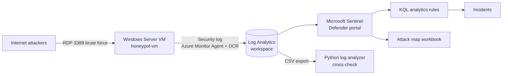

# Azure Sentinel Honeypot Lab

A Windows VM exposed to the internet on RDP, with its security logs sent to **Microsoft Sentinel**. Automated attackers find it within hours. I wrote **KQL detection rules** for brute force, password spraying and successful logons after failures, built an **attack map** of where the attempts came from, triaged the incidents, and cross-checked the results with my [Python log analyzer](https://github.com/Cyril-419/Security-Log-Analyzer).

> **Status:** detections, hunting queries and setup guide are complete. Results and screenshots are added in [RESULTS.md](RESULTS.md) after each run.

## Architecture



| Component | Role |
|---|---|
| Windows Server VM (NSG allows **only** TCP 3389) | The honeypot: logs every logon attempt (Event IDs 4624 / 4625) |
| Azure Monitor Agent + Data Collection Rule | Ships the Windows Security log to the workspace (`SecurityEvent` table) |
| Log Analytics workspace + Microsoft Sentinel | SIEM: storage, KQL queries, analytics rules, incidents |
| `geo_info_from_ip_address()` | Built-in KQL geolocation for the attack map |

## Detections

| Rule | Logic | MITRE ATT&CK | Severity |
|---|---|---|---|
| [Brute force](detections/01_brute_force.kql) | 10+ failed logons from one IP in 5 min | T1110.001 Password Guessing | Medium |
| [Password spraying](detections/02_password_spray.kql) | Failed logons against 5+ **different** accounts from one IP in 5 min | T1110.003 Password Spraying | High |
| [Success after failures](detections/03_success_after_failures.kql) | Successful network/RDP logon from an IP with 5+ recent failures | T1110 → T1078 Valid Accounts | High |

These use the same thresholds as my Python log analyzer, so the two can be compared on the same data. Each rule maps **IP** and **Host** entities and is suppressed for an hour after firing, so a long attack becomes one incident instead of hundreds.

## Hunting queries

[`hunting/hunting_queries.kql`](hunting/hunting_queries.kql) answers the questions an analyst would ask:
1. How much was the honeypot attacked?
2. How long until the first attack?
3. Top attacking IPs, with location
4. Attacks by country
5. Most-tried usernames
6. Attack volume over time
7. Why logons failed (4625 SubStatus: wrong username vs. wrong password)
8. Did anyone actually get in?
9. Export for the Python analyzer

## Repo layout

```
detections/   KQL for the 3 scheduled analytics rules
hunting/      hunting queries used for RESULTS.md
workbook/     attack map workbook (JSON import) and its query
scripts/      sentinel_to_analyzer.py: Sentinel CSV -> Python analyzer format (+ tests)
docs/         SETUP.md: full build guide, cost controls, teardown
screenshots/  evidence from each run
RESULTS.md    findings from the run
```

## Running it yourself

Follow [docs/SETUP.md](docs/SETUP.md). It covers cost controls (budget alert, Sentinel free trial), safety rules for running a honeypot, and deleting everything afterward.

```bash
# convert a Sentinel export and run it through the Python analyzer
python scripts/sentinel_to_analyzer.py honeypot_export.csv -o honeypot_events.json
python -m loganalyzer analyze honeypot_events.json --format windows

# tests for the converter
pip install pytest && python -m pytest scripts/
```

## Design decisions

- **Only RDP is open.** Many versions of this lab open every port and disable the Windows firewall. Scanners find 3389 within hours either way, so one open port gets the same data with less risk.
- **Azure Monitor Agent, not the legacy agent.** The old Log Analytics agent (MMA) is retired; data collection rules define exactly what's collected.
- **No geolocation watchlist.** Older guides upload a large IP-to-location CSV. KQL's built-in `geo_info_from_ip_address()` does it with no setup.
- **Suppression on every rule.** Without it, an attack that lasts hours creates an incident every 5 minutes, which is alert fatigue in miniature.
